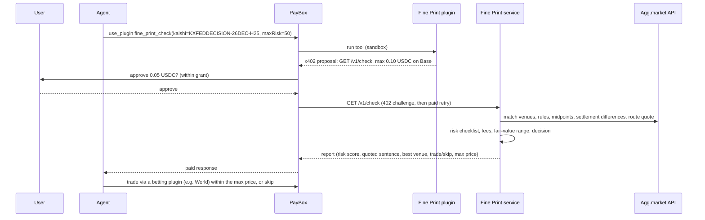
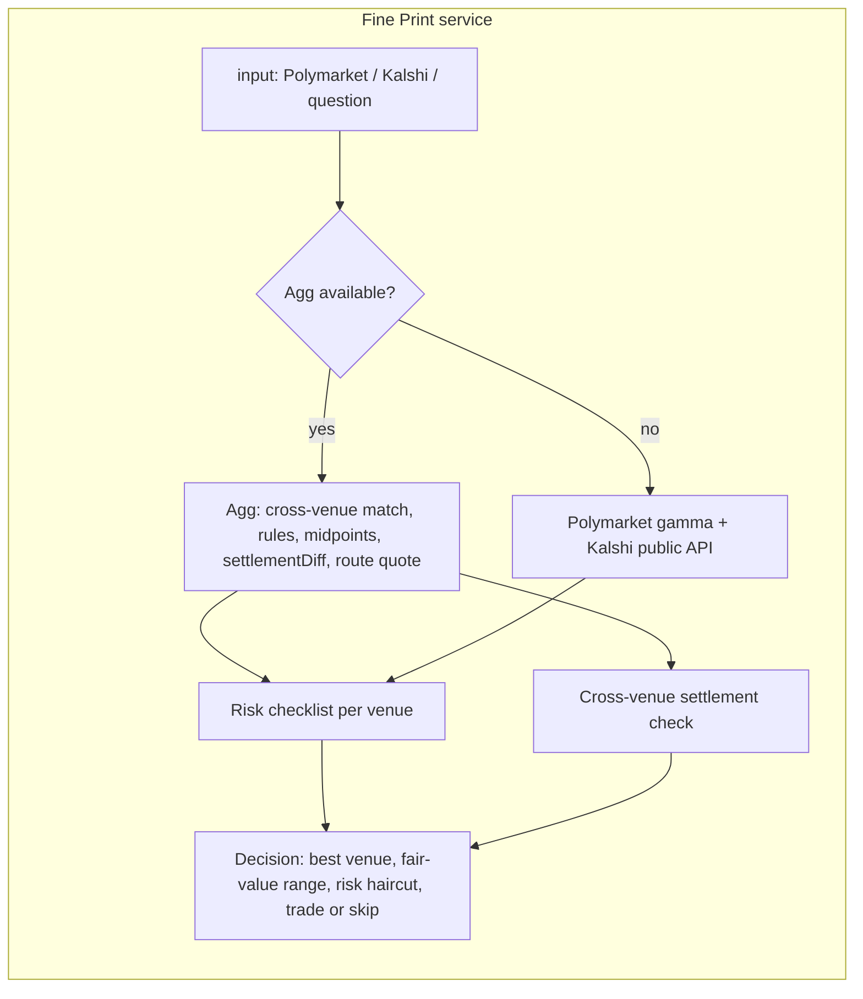

# Fine Print

**A pre-trade check for prediction-market agents.**
*A price is not a probability until it has been tested.*

Fine Print is a paid x402 service, packaged as a PayBox plugin. Before your agent spends your money on a prediction market, it pays a few cents for three answers:

1. **Is this market safe to resolve?** A resolution-risk score from 0 to 100, with the exact risky sentence quoted and a plain explanation.
2. **Where is it cheapest?** YES prices and fees on every venue that lists the same event, and the best venue after fees.
3. **Should I trade?** Trade or skip, with a max price that drops as risk goes up.

## The problem

Agents are starting to bet on prediction markets for people. They see a price and buy. But traders lose money in two ways a price can't show:

- **The market resolves in a way they didn't expect.** "A consensus of credible reporting", "formally ceases to hold the position", "officially announced"... the fine print decides who gets paid.
- **The same event settles differently on different venues.** One venue covers a cancelled meeting and another doesn't. One resolves on the official statement, another on news reports.

A human trader reads the rules. An agent needs a tool that reads them for it, every time, in under a second. Fine Print is that tool, and a PayBox grant can enforce it: *"never enter a market Fine Print scores above 50."*

## How it works





### The risk checklist

Deterministic and rules-based (no LLM), so the same rules always get the same score. Each venue's rules are checked for:

| Check | What raises risk |
|---|---|
| Verifiable source | "credible reporting" as the source (high), or as a fallback next to an official source (medium); no named source at all |
| Resolver discretion | "sole discretion", "reserves the right" |
| Deadline and time zone | a deadline with no time zone |
| Ambiguous wording | "formally", "officially", "announced", "approximately", "intends to" |
| Edge cases | nothing on delays or cancellations; partial outcomes (suspensions, interim roles) excluded; data revisions |
| Dispute process | UMA vote on a vague source; rules that can be "clarified" later |
| Cross-venue settlement | Agg's settlement differences (source, threshold, scope, timing, edge cases), different close dates, cancellation covered on one venue only |

Weights: high 25, medium 12, low 5, capped at 100. 0-29 low, 30-59 medium, 60+ high.

**Effective risk = the venue's own rules risk + cross-venue settlement risk** (capped at 100). This is the number checked against `maxRisk` and used for the price haircut. Both parts are also returned separately (`venueRisk`, `crossVenueRisk`).

**Agg's settlement differences are checked, not trusted blindly.** Fine Print uses Agg's `settlementDiff` summary and per-venue text, then reads every venue's full rules. If Agg says a venue doesn't cover something but its rules do, the flag is downgraded and labelled a correction with the clause quoted (e.g. Agg says Kalshi has no "no statement" fallback, but Kalshi's rules cover a cancelled FOMC meeting, so the real difference is the trigger and timing). A separate one-sided clause check (cancellation, rounding, ties, data revisions, early close, voids) catches what Agg misses, such as Polymarket's "rounded up to the nearest 25" clause.

**Outcome matching backstop.** When Agg matches the events but not the outcome (e.g. Kalshi "Hike >25bps" vs Polymarket "50+ bps increase"), Fine Print parses the outcome ladder (direction + comparator + number, using the ladder step so ">25" on a 25 bps ladder equals "50+") and pairs it only if exactly one candidate matches. Pairs made this way are marked `matchedBy: "fine_print_outcome_parser"`.

### The decision

- **Best venue**: lowest all-in YES cost (price + fee) among venues under your risk limit. The anchor venue is priced with Agg's smart-route quote for your spend; others use top of book plus the venue's fee (Kalshi `0.07·p·(1-p)` rounded up).
- **Fair value**: if you pass `fairValue`, that's used. If not, and at least **two venues have live prices**, Fine Print uses the cross-venue midpoint range and says plainly that it is not claiming an edge. With only one priced venue there is no independent reference, so it skips unless you pass `fairValue`.
- **Max price** = reference × (1 − max(0, effective risk − 20) / 300). The consensus reference is the top of the midpoint range plus the venue fee and 1c. Risk above 20 shaves the price; 50 risk = −10%.
- **Skip** if effective risk ≥ `maxRisk` (default 60), if the best all-in cost is above the max price (reason says whether it's "above the fair-value range" or "cut by the risk haircut"), or if there's no second priced venue and no `fairValue`.
- **Unavailable venues** (timeouts, no live price) are listed with `status: "unavailable"` and a reason, and named in `notes` and the decision reason.

What Fine Print returns is its own analysis: scores, short quotes of the risky sentence, prices, decisions. It never returns full rules text or raw data dumps.

## API

`GET /v1/check` — **paid**, 0.05 USDC on Base via x402 (unpaid dev mode until a receiver address is configured).
`GET /v1/preview` — free: risk score and the main risk only.
`GET /health`

| Param | Meaning |
|---|---|
| `polymarket` | market slug, URL or numeric id |
| `kalshi` | market ticker or URL |
| `q` | plain-language question (Agg search) |
| `fairValue` | your probability for YES, 0-1 |
| `maxRisk` | skip at or above this risk, 0-100 (default 60) |
| `spend` | USD for the route quote (default 20) |

Example (trimmed):

```json
{
  "riskScore": 71, "riskLevel": "high",
  "topRisk": { "check": "verifiable_source", "severity": "high", "venue": "polymarket",
    "quote": "A ceasefire refers to any mutually agreed suspension ... which is officially announced ...",
    "explanation": "Resolves on 'credible reporting' instead of one checkable source..." },
  "decision": { "action": "skip", "reason": "Skip: resolution risk is 71/100 on the safest venue, at or above your limit of 60." }
}
```

## PayBox plugin

`plugin/` is a standard PayBox plugin (starter 1.0.2) that bundles to `plugin/dist/plugin.mjs`:

- `fine_print_check`: returns an `io.paybox/transactionProposal` of kind `x402` (Base USDC, max 0.10) for `GET {FINE_PRINT_URL}/v1/check?...`. PayBox shows the payment, the user approves, PayBox pays and returns the report.
- `fine_print_preview`: free direct call to `/v1/preview`.

Portal setup after deploying the service:

- **Network host**: the service hostname, e.g. `fine-print.vercel.app`.
- **Environment variable** `FINE_PRINT_URL` = the deployed base URL, e.g. `https://fine-print.vercel.app` (must be https, port 443, no query). If unset, `plugin/src/config.ts` `DEFAULT_SERVICE_URL` is used; that's the one place to change it before building.
- No secrets.

## Quick start

```bash
pnpm install
cp .env.example .env    # set AGG_APP_ID; leave FINE_PRINT_PAY_TO empty for dev mode
pnpm dev                # http://localhost:8787
curl "localhost:8787/v1/check?kalshi=KXFEDDECISION-26DEC-H25"
pnpm check '{"polymarket":"2264328","maxRisk":50}'   # CLI, no server
pnpm test

cd plugin && pnpm install --frozen-lockfile && pnpm test   # builds dist/plugin.mjs + PayBox conformance
```

Deploy: `vercel --prod`, with `AGG_APP_ID`, `FINE_PRINT_PAY_TO`, `CDP_API_KEY_ID`, `CDP_API_KEY_SECRET` set as Vercel environment variables. Paid mode turns on automatically when a receiver address and facilitator credentials are present.

## Tests

`pnpm test` (33 tests) runs unit tests on the checklist and decision logic, plus risk-band tests on rules text from 15 live markets (Fed decision, CPI, BTC year-end, GPT-7, Lisa Cook, Russia–Ukraine ceasefire, UK social media ban and more), captured on 2026-10-16 in `test/fixtures/`. Rules text there is as published by the venues.

## Data and credits

Market matching, prices, route quotes and settlement differences come from **[Agg.market](https://agg.market)**, the prediction-market aggregator. Polymarket and Kalshi public APIs are the fallback. Fine Print adds the risk scoring, venue choice and decision on top. Not financial advice.

Built by [@Baheet18](https://github.com/Baheet18) for MoonPay PayBox Chapter 1 (Predictions track).
